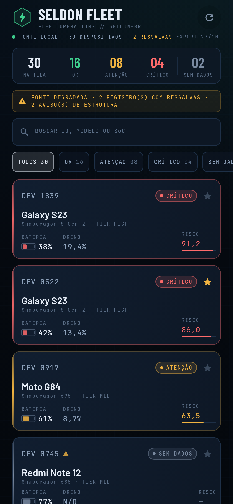
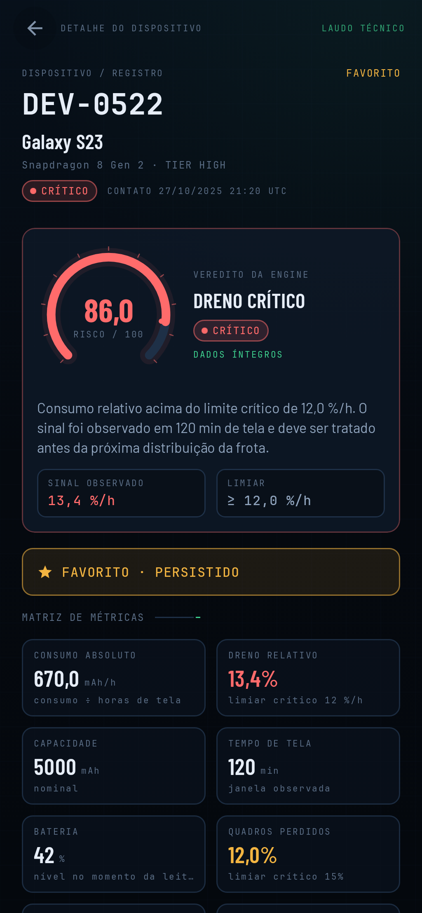

# Seldon Fleet

Aplicativo Android em Kotlin e Jetpack Compose para leitura local de uma frota
de dispositivos, classificação de saúde por uma regra de domínio pura e
navegação entre lista e detalhe. O app não usa rede, login, banco relacional ou
telas adicionais.





As duas imagens são renderizações dos previews Compose do próprio app, geradas
com `android preview render` no host. O ambiente usado para o desenvolvimento
não tinha hypervisor disponível para iniciar um AVD; por isso a captura foi
feita pelo renderizador oficial de Compose Preview, sem emulador. O layout é o
mesmo das telas de produção; os dados das imagens são uma amostra representativa
do arquivo oficial.

## O que o app faz

- Lê `app/src/main/assets/frota.json` sem acesso à internet.
- Normaliza energia em `mWh` para `mAh` usando a tensão nominal.
- Classifica cada dispositivo como `OK`, `ATENCAO`, `CRITICO` ou
  `INDETERMINADO`, com precedência `INDETERMINADO > CRITICO > ATENCAO > OK`.
- Lista todos os dispositivos com identificador, modelo, bateria e chip de
  status; permite filtrar por status, buscar e favoritar.
- Abre o detalhe com atributos, derivadas, justificativa da classificação e o
  valor observado que disparou o veredito.
- Persiste favoritos em DataStore; o arquivo de frota é relido a cada abertura.

No arquivo oficial de 30 dispositivos, o resultado é **16 OK, 8 ATENÇÃO,
4 CRÍTICO e 2 INDETERMINADO**.

## Requisitos

- JDK 17.
- Android SDK com `compileSdk 35`.
- Android Studio ou Gradle Wrapper.

## Como executar

No Windows:

```powershell
.\gradlew.bat :app:assembleDebug
.\gradlew.bat :app:testDebugUnitTest
.\gradlew.bat :app:lintDebug
```

O APK de debug é gerado em
`app/build/outputs/apk/debug/app-debug.apk`.

Para instalar em um emulador ou aparelho conectado:

```powershell
adb install -r app\build\outputs\apk\debug\app-debug.apk
adb shell am start -n com.seldon.fleet/.MainActivity
```

## Arquitetura

```text
app/src/main/java/com/seldon/fleet/
├── domain/       modelos, FleetAnomalyEngine, interface de repositório e use cases
├── data/         parser defensivo, assets, DataStore e implementação do repositório
├── presentation/ lista, detalhe, ViewModels, navegação e componentes Compose
├── di/           módulos Hilt
└── ui/theme/     tema, tipografia e visuais de status
```

A regra de dependência é respeitada:

- `domain/` é Kotlin puro; não importa `android.*`, JSON, `Context` ou Compose.
- `data/` implementa a interface de repositório declarada em `domain/`.
- `presentation/` consome `StateFlow` imutável de cada ViewModel.
- A classificação não está em Composable nem no parser.

## Decisões e trade-offs

- **Regra oficial em vez de calibrar thresholds:** a regra da especificação foi
  mantida para preservar rastreabilidade e evitar ajuste depois de ver o
  resultado.
- **Dados incompletos viram `INDETERMINADO`:** não excluímos o dispositivo, não
  inventamos valores e não derrubamos a ingestão inteira. O raciocínio completo
  está em [PROTOCOLO.md](PROTOCOLO.md).
- **`mWh` normalizado na camada de dados:** o domínio recebe apenas `mAh` e não
  conhece a unidade de origem.
- **Índice de risco auxiliar:** a lista e o detalhe exibem um índice 0–100, mas
  ele não altera o status oficial. Para `INDETERMINADO`, não há risco calculável.
- **Favoritos em DataStore:** suficiente para conjuntos de IDs e sem a
  complexidade de Room.
- **UI mais elaborada que o mínimo:** o tema de console, animações e painéis
  ajudam a leitura, mas não são requisitos. A prioridade da entrega é a regra
  testável e a documentação.

## Testes

A suíte roda na JVM, sem emulador:

```bash
./gradlew :app:testDebugUnitTest
```

Cobertura principal:

- equivalência física entre `mAh` e `mWh`;
- capacidade zero, ausente e `screenOnMinutes` zero;
- valores imediatamente abaixo, exatamente no limiar e imediatamente acima;
- precedência entre sinais e `INDETERMINADO`;
- dados corrompidos, tipos inválidos, campos ausentes e IDs duplicados;
- distribuição oficial `16 / 8 / 4 / 2`;
- filtros, contagens, favoritos e erros de ViewModel.

## Integração contínua

O workflow em `.github/workflows/ci.yml` executa análise estática (`lintDebug`)
e testes JVM (`testDebugUnitTest`) a cada push e pull request. Neste workspace
não há remote Git configurado nem credenciais do GitHub disponíveis; por isso a
execução remota do CI deve ser confirmada depois do push para o repositório de
entrega. Localmente, os mesmos comandos estão verdes.

## O que eu faria em seguida

1. **Testes de UI/instrumentação** para o fluxo de navegação e para a
   persistência de favoritos depois de encerrar o processo.
2. **Ground truth independente** para avaliar se os limiares oficiais são
   adequados à frota, em vez de usar a própria regra como referência.
3. **Calibração por tier de SoC** e por janela de observação, com uma amostra
   maior do que 30 registros.
4. **Modelo de dreno mais realista** que considere consumo com a tela desligada
   e serviços em primeiro plano, reduzindo falsos `CRITICO`.
5. **Trilha A opcional** com um segundo classificador orientado por dados
   (percentil ou modelo simples) e comparação explícita contra a linha de base.
   Não incluída nesta entrega.
6. **Redução de warnings do lint** e verificação automatizada de acessibilidade.

## Uso de IA

A implementação e a documentação contaram com assistência de IA para
scaffolding, escrita de código, revisão e redação. As decisões de arquitetura,
a escolha da regra, o tratamento dos defeitos e as limitações descritas no
`PROTOCOLO.md` foram revisados e devem ser defendidos na entrevista técnica.

## Fonte dos dados

O arquivo `frota.json` é empacotado em assets e tratado como somente leitura.
Os únicos dados persistidos são os IDs favoritados.
